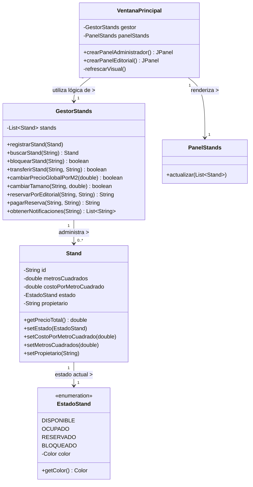

# Diagrama de Clases - Sistema de Stands

Este diagrama representa la arquitectura actual del sistema, dividida en capas lógicas (Datos, Negocios y UI), soportando el cálculo dinámico y la interfaz visual.

